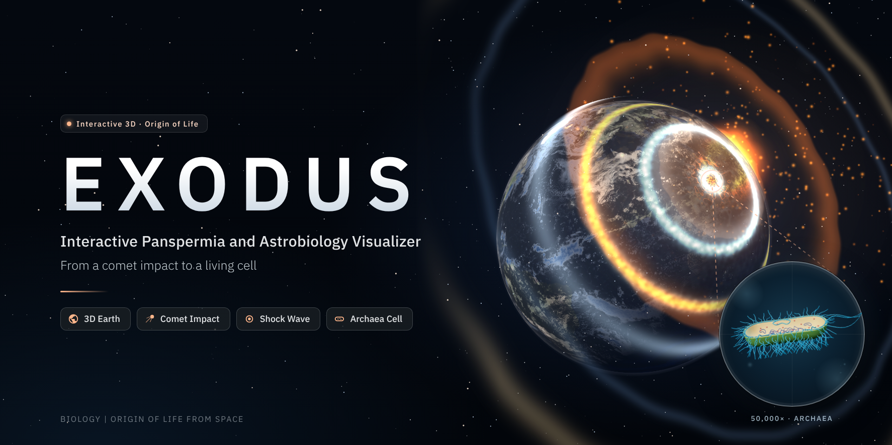
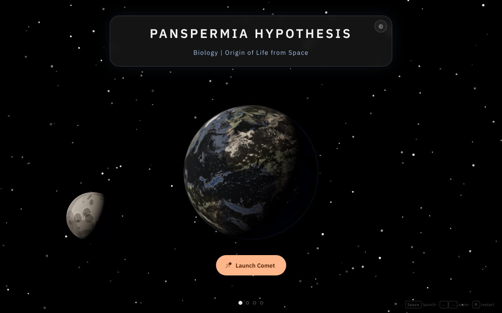
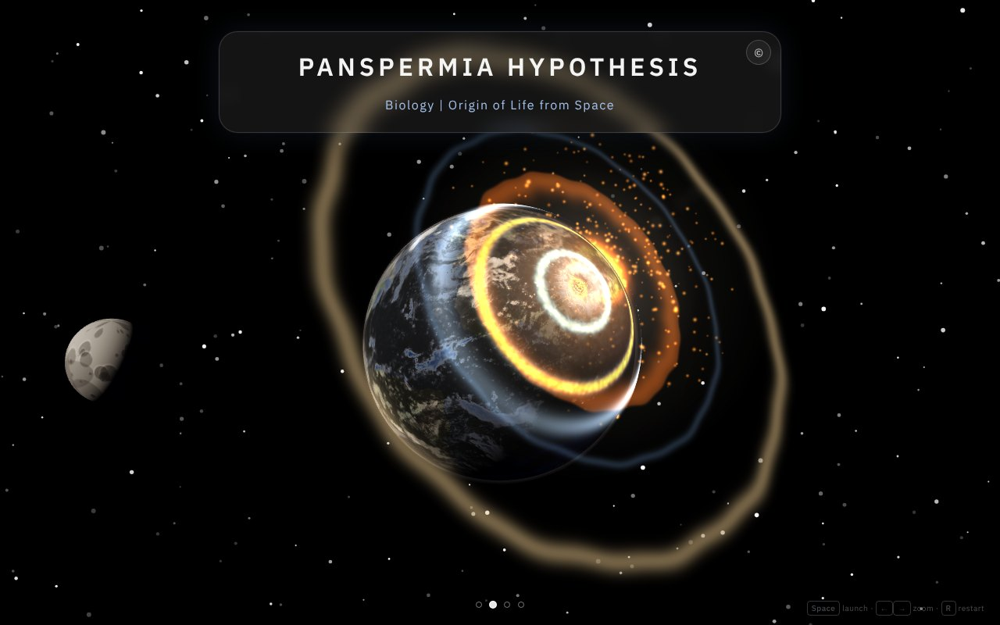
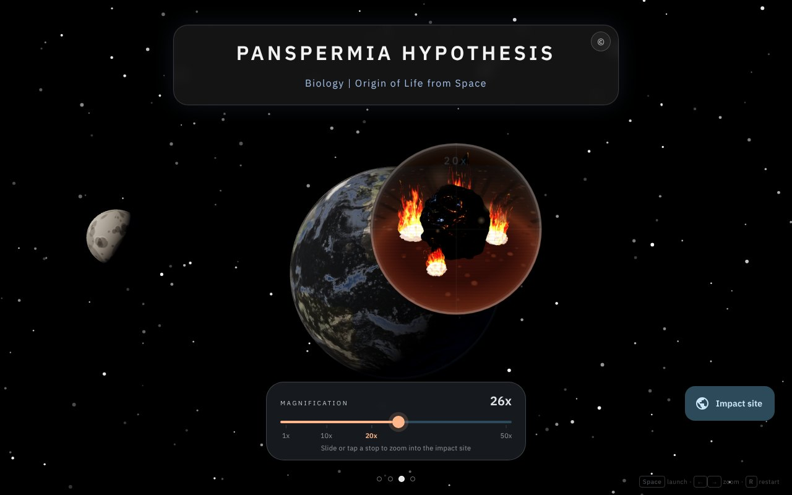
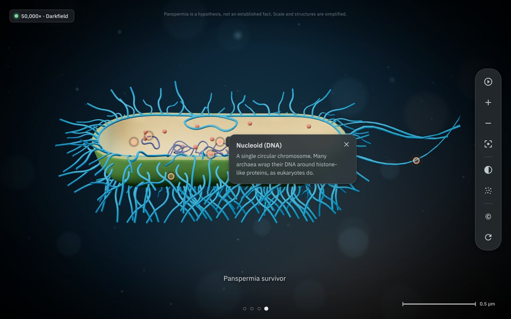

  

<h1 align="center">EXODUS</h1>

<em>Interactive Panspermia and Astrobiology Visualizer</em>

<a href="https://exodus.stark-kodex.workers.dev"><strong>Launch the Simulator</strong></a>

  <a href="#about">About</a> ·
  <a href="#screenshots">Screenshots</a> ·
  <a href="#stages">Stages</a> ·
  <a href="#controls">Controls</a> ·
  <a href="#science">Science</a> ·
  <a href="#technology">Technology</a> ·
  <a href="#credits">Credits</a> ·
  <a href="#releases">Releases</a> ·
  <a href="#license">License</a>

<em>Project dedicated to Lord Vishnu</em>

---

## About

An interactive 3D visualizer of the panspermia hypothesis for Biology (Origin of Life). A comet strikes a 3D Earth and sends a shock wave around the globe, then a lens zooms from the crater to the burning rock and into the microbe it carried: an archaeon, explored in 3D.

Built for classroom smart panels, with keyboard and clicker control. The repository runs from any web server, and the single-file build runs straight from a pen drive.

---

## Screenshots

<table width="100%">
  <tr>
    <td width="50%" align="center">
      
       <b>1 · Earth</b>
    </td>
    <td width="50%" align="center">
      
       <b>2 · Impact Wave</b>
    </td>
  </tr>
  <tr>
    <td width="50%" align="center">
      
       <b>3 · Burning Rock</b>
    </td>
    <td width="50%" align="center">
      
       <b>4 · Archaea</b>
    </td>
  </tr>
</table>

---

## Stages

| Stage | What You See | Tap to Explore |
|:--|:--|:--|
| **1 · Earth** | Earth with clouds, night-side city lights and the Moon in orbit | Launch Comet |
| **2 · Impact** | The comet streaks in, strikes Earth and sends shock waves around the globe, with blast rings, ejecta and a smoking crater | Impact site |
| **3 · Zoom** | A lens follows the crater: crater floor at 10x, burning rock at 20x, the microbe at 50x | 1x · 10x · 20x · 50x stops |
| **4 · Archaea** | 3D cutaway of an archaeon at 50,000x in a darkfield-microscope view, with a live µm scale bar and guided tour | S-layer · Plasma membrane · Cytoplasm · Nucleoid · Plasmid · Ribosomes · Archaella and pili |

**Concepts:** panspermia hypothesis · lithopanspermia · impact events · Archaea and extremophiles · S-layer cell wall · ether-linked membrane lipids · nucleoid and plasmids · 70S ribosomes · archaella · magnification and scale

---

## Controls

| Control | Function |
|:--|:--|
| Launch Comet · Impact site | Start the impact · Turn the crater towards you |
| Zoom slider | Slide or tap a stop; 50x enters the cell |
| Drag · Pinch or scroll | Rotate · Zoom the cell |
| Tap a dot | Open its info card; tap empty space to close |
| Cell toolbar | Guided tour · Zoom · Reset view · High contrast · Grain · Restart |
| Keyboard or clicker · © | Space launch · Arrows zoom or next step · R restart · Credits |

---

## Science

<b>Key figures</b>

| Feature | Figure |
|:--|:--|
| Archaeal cell size | About 0.1–15 µm; most 0.5–5 µm |
| Ribosomes | 70S, as in bacteria |
| Highest known growth temperature | 122 °C (*Methanopyrus kandleri* strain 116) |
| Cell view magnification | 50,000x |

<b>Structures and processes</b>

| Topic | Summary |
|:--|:--|
| Panspermia | The hypothesis that life, or its seeds, can travel between worlds; it does not explain how life first began |
| Lithopanspermia | Microbes shielded inside rocks thrown off by impacts; the rock's interior can stay cool while its surface burns on entry |
| S-layer | Crystalline protein cell wall; archaea lack peptidoglycan, a few have pseudopeptidoglycan |
| Plasma membrane | Branched isoprenoid lipids joined to glycerol by ether bonds; some form a heat-stable monolayer |
| Nucleoid and plasmids | Circular chromosome, often packed with histone-like proteins, plus small DNA rings |
| Ribosomes | 70S, with proteins and antibiotic sensitivity closer to eukaryotic ribosomes |
| Archaella and pili | Archaella rotate for swimming and are built like type IV pili; pili aid attachment |

Panspermia is a hypothesis, not an established fact. Scale and structures are simplified for teaching.

---

## Technology

HTML · CSS · JavaScript · Three.js r170 · Material Design 3 · Cloudflare Pages

<b>Project files</b>

| File | Contents |
|:--|:--|
| `index.html` | Page structure and credits card |
| `style.css` | Styling, Material Design 3 theme |
| `script.js` | Story flow, zoom lens, controls, keyboard shortcuts |
| `scene3d.js` | 3D Earth, comet, impact wave, lens views, cell viewer |
| `models/` | Earth, comet rock, fire and archaeon (`.glb`, Meshopt and WebP compressed) |
| `vendor/three/` | Three.js r170 with GLTFLoader, OrbitControls and the Meshopt decoder |
| `assets/banner.png` | README banner |
| `assets/screenshots/` | README screenshots, numbered in display order |

---

## Credits

| Contributor | Role |
|:--|:--|
| **Aditya Sai Prasad**, MSc. Agri Entomology, ASRB NET | Project Designer |
| Claude Opus 5.5 | Development |

<b>3D models</b>

| Asset | Model | Creator | Licence |
|:--|:--|:--|:--|
| Earth | [Earth](https://sketchfab.com/3d-models/earth-4de1bcbd22a444abb4f089b9b78ec96a) | SebastianSosnowski | CC BY 4.0 |
| Comet rock | [asteroid](https://sketchfab.com/3d-models/asteroid-80a70567fb2a42df836e6d70204e0b68) | admone | CC BY 4.0 |
| Crater fire | [bonfire](https://sketchfab.com/3d-models/bonfire-dc8010abcb3649708aabe29f3f5eafe7) | raptapantallas | CC BY 4.0 |
| Archaeon | [Archaea](https://sketchfab.com/3d-models/archaea-eb47b67df9ca4c47b681716d572e3177) | arloopa | CC BY 4.0 |

Models were compressed and adapted for this visualizer: the Earth cloud layer is re-projected, and only the flames and coals of the bonfire are used. Original creators retain ownership. [CC BY 4.0](https://creativecommons.org/licenses/by/4.0/)

<b>Libraries and fonts</b>

| Component | Licence |
|:--|:--|
| Three.js r170 | MIT |
| IBM Plex Sans · Roboto | SIL Open Font License 1.1 |

---

## Releases

| Release | Title | Date |
|:--|:--|:--|
| RC II | 3D Earth and Archaea | 26 Nov 2026 |
| RC I | Initial Release | 13 Jun 2026 |

Full history: [CHANGELOG.md](CHANGELOG.md)

---

## License

Source code: **GNU GPL-3.0** (see [LICENSE](LICENSE)). 3D models keep their own licences.

GitHub · Codeberg &nbsp;|&nbsp; Hosted on Cloudflare Pages

