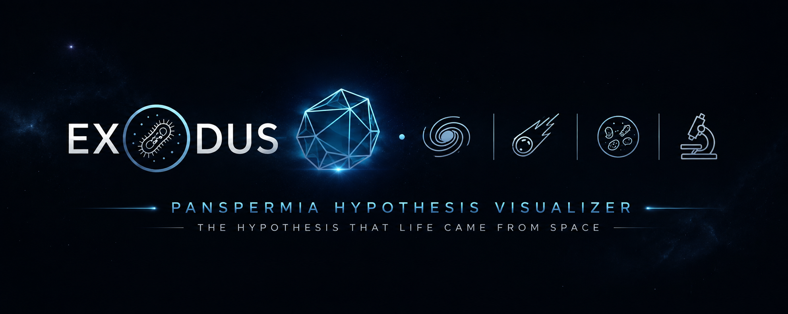
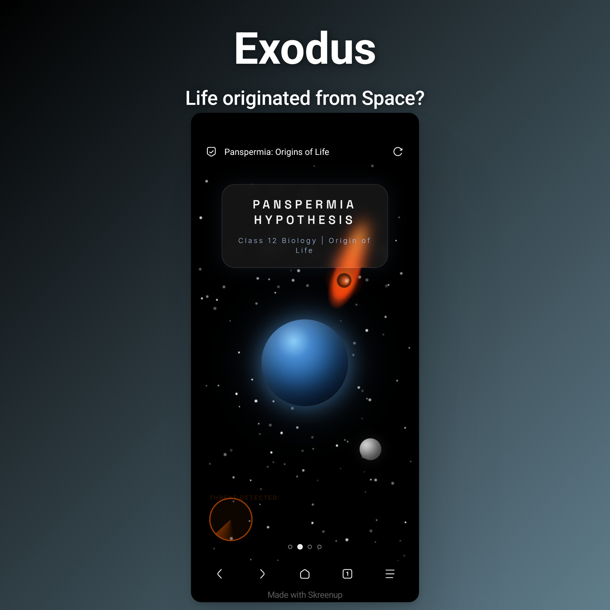
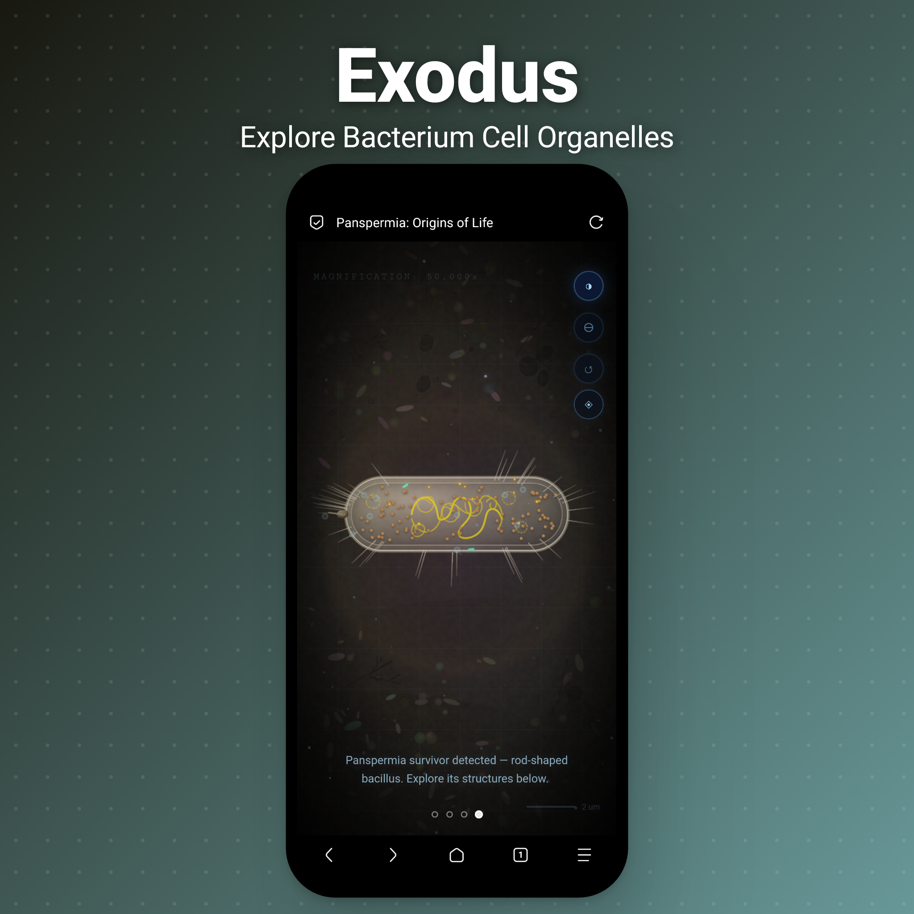

  

<h1 align="center">🦠 EXODUS</h1><h3 align="center"><em>Interactive Panspermia & Astrobiology Visualizer</em></h3>An interactive educational visualization exploring panspermia, microbial survival under extreme conditions, and the proposed transfer of microorganisms through space.

  <a href="https://exodus.stark-kodex.workers.dev"><strong>Explore Exodus →</strong></a>

---

✨ **Features**

- 🧬 Interactive Cell Anatomy — Explore prokaryotic cell structures.
- 🚀 Panspermia Mechanisms — Visualize proposed microbial transfer through space.
- 🔬 Scientific Visualization — Explore microbiology and astrobiology concepts.
- 📱 Responsive Interface — Designed for desktop and mobile browsers.

---

🖼️ **Screenshots**

<table>
  <tr>
    <th align="center">Before Collision</th>
    <th align="center">After Collision</th>
  </tr>
  <tr>
    <td align="center" width="50%">
      
    </td>
    <td align="center" width="50%">
      
    </td>
  </tr>
</table>

---

🧬 **Core Concepts**

Panspermia · Prokaryotic Cell Structure · Extremophile Biology · Microbial Transfer · Astrobiology

---

🧑🏻‍💻 **Technology**

HTML · CSS · JavaScript · Three.js
Source: GitHub & Codeberg
Deployment: Cloudflare Pages

---

📜 **License**

Distributed under the "GNU GPL-3.0 License" (LICENSE). Third-party assets remain subject to their respective licenses.
