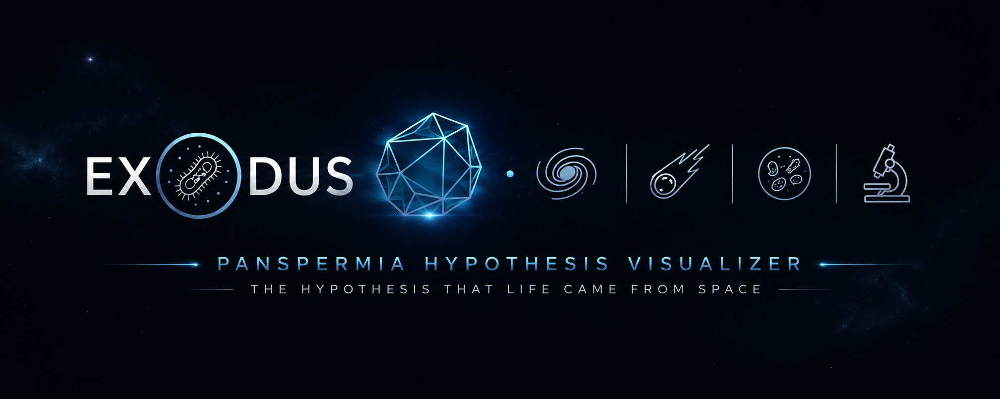
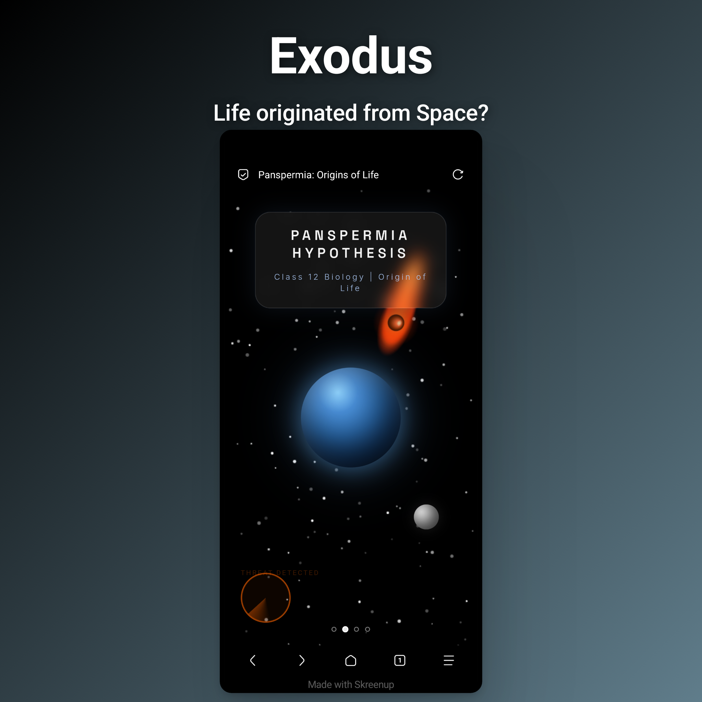
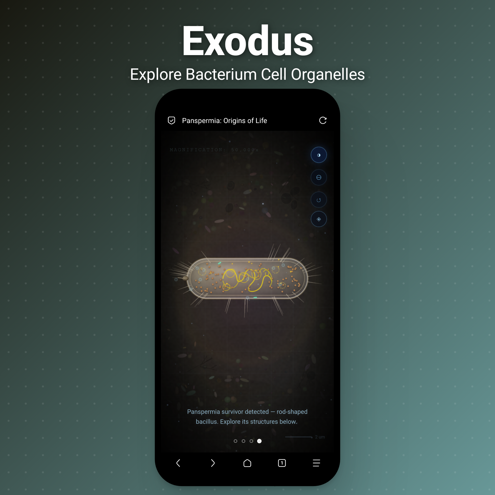

  

<h1 align="center">🦠 EXODUS</h1>

<em>Interactive Panspermia & Astrobiology Visualizer</em>

<a href="https://exodus.stark-kodex.workers.dev"><strong>Explore Exodus →</strong></a>

  <a href="#-about">About</a> ·
  <a href="#%EF%B8%8F-screenshots">Screenshots</a> ·
  <a href="#-the-story-in-four-steps">Story</a> ·
  <a href="#-inside-the-cell">The cell</a> ·
  <a href="#-concepts-covered">Concepts</a> ·
  <a href="#-controls">Controls</a> ·
  <a href="#-technology">Technology</a> ·
  <a href="#-license">License</a>

---

<em>Project dedicated to Lord Vishnu</em>

---

## 📖 About

An interactive visualization of the **panspermia hypothesis** for Class 12 Biology (Origin of Life): the proposal that microorganisms could travel through space and arrive on a planet.

The story starts in space, follows a rock to Earth, then zooms all the way into the microbe it carries, so students can:

- **follow the hypothesis** from impact to a living cell
- **zoom in** from a planet to a crater to a single bacterium
- **explore the structures** of a prokaryotic cell, one at a time

Designed for desktop and mobile browsers.

---

## 🖼️ Screenshots

<table>
  <tr>
    <th align="center">Before Collision</th>
    <th align="center">After Collision</th>
  </tr>
  <tr>
    <td align="center" width="50%">
      
    </td>
    <td align="center" width="50%">
      
    </td>
  </tr>
</table>

---

## 🚀 The Story in Four Steps

A row of four dots at the top marks where you are in the story.

| Step | What happens |
|:--|:--|
| **1 · Panspermia Hypothesis** | Earth and the Moon sit in a field of stars. Press ▶ to originate panspermia. |
| **2 · Impact** | A "Threat Detected" radar appears and a glowing rock streaks in and strikes Earth, leaving a crater. Press 🌍 to turn Earth so the impact site faces you. |
| **3 · Zoom** | A zoom lens opens over the impact site. Slide it from **1x to 50x**: the crater appears from 10x, the smoking rock from 20x, and at 50x the lens reports "Prokaryote detected". |
| **4 · The cell** | The view enters a scanning-electron-microscope style display at **50,000x** with a 2 µm scale bar, and a rod-shaped bacillus is shown. An arrow-and-bubble guided tour walks through its structures. |

---

## 🔬 Inside the Cell

Tap any label to open a card with its name and description and to highlight the structure.

| Structure | What the simulator teaches |
|:--|:--|
| **Peptidoglycan cell wall** | A rigid mesh of sugar–peptide chains that gives the cell its shape and protects it from osmotic pressure |
| **Plasma membrane** | A phospholipid bilayer that controls what enters and leaves the cell |
| **Cytoplasm** | The gel-like fluid that holds the ribosomes, DNA and metabolic machinery |
| **Nucleoid (DNA)** | The region where the single circular chromosome is coiled |
| **Plasmid DNA** | Three small circular DNA rings, separate from the chromosome, often carrying survival or antibiotic-resistance genes |
| **Ribosomes** | The machines that translate mRNA into protein; prokaryotic ribosomes (70S) are smaller than eukaryotic ones |
| **Flagellum** | A single polar flagellum (monotrichous), turned by a rotary motor at its base, that propels the cell |
| **Pili** | Short protein fibres for attachment and cell-to-cell contact, enabling DNA transfer by conjugation |

The guided tour visits them in this order: flagellum, pili, nucleoid, plasmid, ribosomes, cell wall, plasma membrane.

---

## 🌱 Concepts Covered

| Area | Concepts |
|:--|:--|
| Origin of life | The panspermia hypothesis · Proposed transfer of microorganisms through space |
| Prokaryotic cell | Cell wall and plasma membrane · Cytoplasm · Nucleoid · Plasmids · 70S ribosomes · Flagellum · Pili |
| Genetics | Circular chromosome · Plasmids and resistance genes · Conjugation |
| Microscopy | Magnification · Scale bar · Electron-microscope style imaging |

---

## 🧭 Controls

| Control | What it does |
|:--|:--|
| ▶ | Starts the story: launches the rock |
| 🌍 / ↩ | Turns Earth to show the impact site, and back |
| **Zoom slider** | Zooms the lens from 1x to 50x; reaching 50x enters the cell |
| **Tap a label** | Opens its info card and highlights the structure; tap elsewhere to close |
| ◑ | Switches high contrast on or off in the cell view |
| ⊖ | Steps the cell view out through three zoom levels, then back to normal |
| ◈ | Turns the electron-microscope grain texture on or off |
| ↺ | Restarts the simulation from the beginning |

---

## 🔭 A Note on the Science

Panspermia is a **hypothesis**, not an established fact. This simulator is a stylised classroom illustration of the idea, and the magnifications, scale and the cell itself are simplified for teaching.

---

## 💻 Technology

HTML · CSS · JavaScript (canvas and SVG graphics, no external 3D library)

Source: GitHub & Codeberg · Deployment: Cloudflare Pages

---

## 📜 License

Source code: **GNU GPL-3.0** (see [LICENSE](LICENSE)). Third-party assets remain subject to their respective licences.

---

  <b>Repository</b>: GitHub · Codeberg &nbsp;&nbsp;|&nbsp;&nbsp; <b>Hosting</b>: Cloudflare Pages

