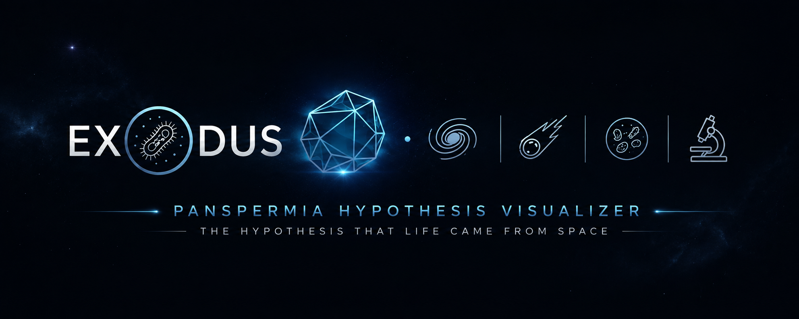
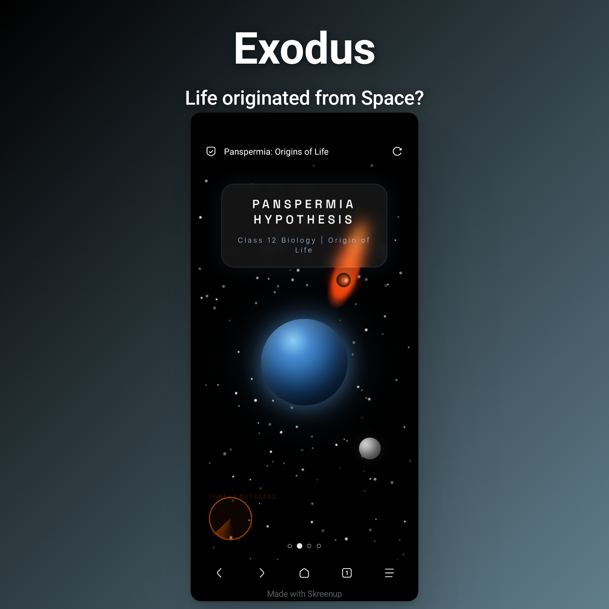
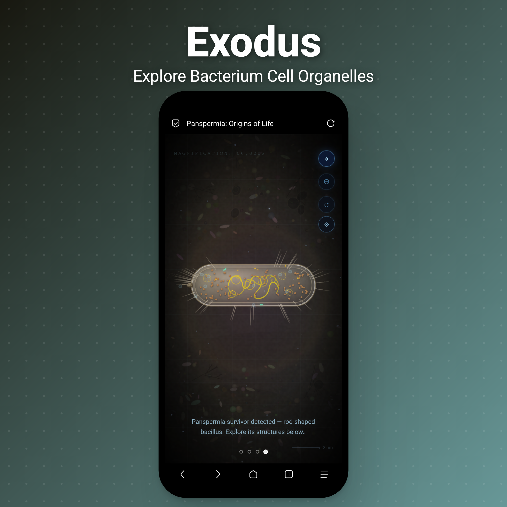

  

<h1 align="center">EXODUS</h1>

<em>Interactive Panspermia and Astrobiology Visualizer</em>

<a href="https://exodus.stark-kodex.workers.dev"><strong>Launch the Simulator</strong></a>

  <a href="#about">About</a> ·
  <a href="#screenshots">Screenshots</a> ·
  <a href="#the-story-in-four-steps">Story</a> ·
  <a href="#inside-the-cell">Inside the Cell</a> ·
  <a href="#concepts-covered">Concepts</a> ·
  <a href="#controls">Controls</a> ·
  <a href="#scientific-note">Scientific Note</a> ·
  <a href="#technology">Technology</a> ·
  <a href="#credits">Credits</a> ·
  <a href="#releases">Releases</a> ·
  <a href="#license">License</a>

---

<em>Project dedicated to Lord Vishnu</em>

---

## About

EXODUS is an interactive visualization of the **panspermia hypothesis** for Class 12 Biology (Origin of Life): the proposal that microorganisms could travel through space and arrive on a planet.

The story begins in space, follows a rock to Earth, then zooms into the microbe it carries, so students can:

- **Follow the hypothesis** from impact to a living cell
- **Zoom in** from a planet to a crater to a single bacterium
- **Explore the structures** of a prokaryotic cell, one at a time

Designed for desktop and mobile browsers.

---

## Screenshots

<table width="100%">
  <tr>
    <td width="50%" align="center">
      
       <b>Before Collision</b>
    </td>
    <td width="50%" align="center">
      
       <b>After Collision</b>
    </td>
  </tr>
</table>

---

## The Story in Four Steps

Four dots at the top mark your place in the story.

| Step | Stage | What Happens |
|:-:|:--|:--|
| 1 | **Panspermia Hypothesis** | Earth and the Moon sit in a field of stars. Press Play to begin. |
| 2 | **Impact** | A "Threat Detected" radar appears and a glowing rock strikes Earth, leaving a crater. Press the Earth button to turn the impact site towards you. |
| 3 | **Zoom** | A lens opens over the impact site. Slide it from **1x to 50x**: the crater appears at 10x, the smoking rock at 20x, and at 50x the lens reports "Prokaryote detected". |
| 4 | **The Cell** | A scanning-electron-microscope style view at **50,000x** with a 2 µm scale bar shows a rod-shaped bacillus. A guided tour walks through its structures. |

---

## Inside the Cell

Tap any label to open its info card and highlight the structure.

| Structure | Description |
|:--|:--|
| **Peptidoglycan cell wall** | Rigid mesh of sugar–peptide chains; gives the cell its shape and protects it from osmotic pressure |
| **Plasma membrane** | Phospholipid bilayer that controls what enters and leaves the cell |
| **Cytoplasm** | Gel-like fluid holding the ribosomes, DNA and metabolic machinery |
| **Nucleoid (DNA)** | Region where the single circular chromosome is coiled |
| **Plasmid DNA** | Three small circular DNA rings, separate from the chromosome, often carrying survival or antibiotic-resistance genes |
| **Ribosomes** | Translate mRNA into protein; prokaryotic (70S) ribosomes are smaller than eukaryotic ones |
| **Flagellum** | Single polar flagellum (monotrichous), turned by a rotary motor at its base |
| **Pili** | Short protein fibres for attachment and cell-to-cell contact, enabling DNA transfer by conjugation |

**Guided tour order:** flagellum, pili, nucleoid, plasmid, ribosomes, cell wall, plasma membrane.

---

## Concepts Covered

| Area | Concepts |
|:--|:--|
| Origin of life | Panspermia hypothesis · Proposed transfer of microorganisms through space |
| Prokaryotic cell | Cell wall and plasma membrane · Cytoplasm · Nucleoid · Plasmids · 70S ribosomes · Flagellum · Pili |
| Genetics | Circular chromosome · Plasmids and resistance genes · Conjugation |
| Microscopy | Magnification · Scale bar · Electron-microscope style imaging |

---

## Controls

| Control | Function |
|:--|:--|
| Play | Start the story and launch the rock |
| Earth / Back | Turn Earth to show the impact site, and back |
| Zoom slider | Zoom the lens from 1x to 50x; reaching 50x enters the cell |
| Tap a label | Open its info card and highlight the structure; tap elsewhere to close |
| High Contrast | Toggle high contrast in the cell view |
| Zoom Out | Step the cell view out through three zoom levels, then back to normal |
| Grain | Toggle the electron-microscope grain texture |
| Restart | Restart the simulation from the beginning |

---

## Scientific Note

Panspermia is a **hypothesis**, not an established fact. This simulator is a stylised classroom illustration of the idea; magnifications, scale and the cell itself are simplified for teaching.

---

## Technology

| Layer | Tool |
|:--|:--|
| Structure | `index.html` |
| Styling | `style.css` |
| Logic | `script.js` |
| Graphics | Canvas and SVG (no external 3D library) |
| Typefaces | Inter and Space Grotesk (Google Fonts) |
| Hosting | Cloudflare Pages |
| Repository | GitHub, mirrored to Codeberg |

---

## Credits

| Contributor | Role |
|:--|:--|
| **Sai Prasad**, M.Sc. Ag. Entomology, NET | Project Designer |
| Claude Opus 5.5 | Development (AI-assisted) |

**Libraries and Assets**

| Component | Licence |
|:--|:--|
| Inter | SIL Open Font License 1.1 |
| Space Grotesk | SIL Open Font License 1.1 |

---

## Releases

| Release | Title |
|:--|:--|
| RC I | Initial Release |

---

## License

Original source code is licensed under **GNU GPL-3.0** (see [LICENSE](LICENSE)). Third-party assets keep their own licences.

---

  <b>Repository:</b> GitHub · Codeberg &nbsp;|&nbsp; <b>Hosting:</b> Cloudflare Pages

